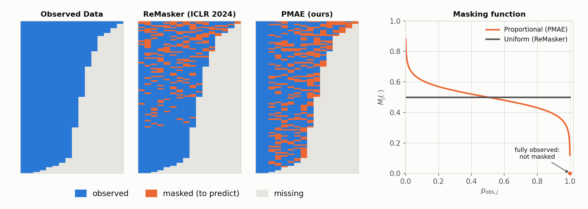

# PMAE

Official code for **To Predict or Not to Predict? Proportionally Masked Autoencoders for Tabular Data Imputation** (AAAI 2025).
Jungkyu Kim, Kibok Lee, Taeyoung Park. [[Paper]](https://ojs.aaai.org/index.php/AAAI/article/view/33967) [[arXiv]](https://arxiv.org/abs/2412.19152) [[PyPI]](https://pypi.org/project/pmae/)

## 💡 Why PMAE

**Missingness differs from column to column, and the masking used to train an imputer should follow it.** A masked autoencoder for imputation masks part of the observed entries during training and learns to predict them from the remaining ones.

- **ReMasker** (ICLR 2024) masks half of every row's tokens, choosing the missing entries first, so observed entries are masked only in rows that are more than half observed, whatever the column.
- **PMAE** masks the observed entries of column *j* with probability *M<sub>j</sub>* = *a* · log((1 − *p<sub>j</sub>*) / *p<sub>j</sub>*) + *b* (*a* = 0.05, *b* = 0.5), where *p<sub>j</sub>* is the column's observed proportion in the batch; fully observed columns are never masked.

**Idea.** As in inverse probability weighting ([Rosenbaum & Rubin, 1983](https://doi.org/10.1093/biomet/70.1.41); [Seaman & White, 2013](https://doi.org/10.1177/0962280210395740)), what is observed less often should weigh more. In other words, the less a column is observed, the more of its entries become *prediction targets*.

<picture>
  <source media="(prefers-color-scheme: dark)" srcset="https://raw.githubusercontent.com/normal-kim/PMAE/main/assets/overview_dark.png">
  
</picture>

## 🏗️ Architecture

```text
row with masked entries
  ─► tokens    numerical value → shared linear map, category → learned embedding; + position, [CLS]
  ─► encoder   6 blocks; masked and missing entries read as zero
  ─► decoder   4 blocks; a learned mask token at the masked and missing positions
  ─► heads     a value per numerical column, a softmax over the categories per categorical column
  ─► loss      per column, the mean error over its observed entries, masked or not (Eq. 4)
```

Both encoder and decoder stack pre-norm residual blocks of one of two types (Eqs. 12–13 of the paper):

| | Mixing across columns | Mixing within a column token |
|---|---|---|
| **PMAE-trf** | x ← x + SelfAttention(LN(x)), 4 heads | x ← x + MLP(LN(x)) |
| **PMAE-mix** | x ← x + MLP<sub>tokens</sub>(LN(x)), an MLP over the column axis | x ← x + MLP(LN(x)) |

Columns of tabular data often interact in groups rather than in pairs ([T2G-Former](https://ojs.aaai.org/index.php/AAAI/article/view/26272), AAAI 2023). Self-attention combines columns through soft pairwise weights, whereas the non-linear token-mixing MLP of [MLP-Mixer](https://arxiv.org/abs/2105.01601) (NeurIPS 2021) can capture such group interactions more flexibly.

## ⚙️ Install

Python 3.10–3.12.

```bash
pip install pmae
```

To run the experiments, clone this repository and create the exact environment used for the results:

```bash
git clone https://github.com/normal-kim/PMAE.git && cd PMAE
conda env create -f environment.yml && conda activate pmae
```

## 🚀 Use PMAE on your own data

```python
from pmae import PMAE

imputer = PMAE(blocks="mixer")                           # blocks="transformer" for PMAE-trf
X_filled = imputer.fit_transform(X, categorical=[3, 4])
X_new_filled = imputer.transform(X_new)                  # rows the imputer was not fit on
```

| Input | Shape | Type | Content |
|---|---|---|---|
| `X` | `(n, d)` | float | numerical columns as values, categorical columns as integer codes `0 … K_j−1`; `NaN` where missing |
| `categorical` | `d_cat` | list of int | positions of the categorical columns |

It returns `X` with every missing entry filled: numerical values on the input scale, and a category code for every categorical entry.

### Build your own imputer

Any object with `fit(X, categorical)` and `transform(X)` can be evaluated on the same scenarios. It receives the encoded splits (step 4 of the Pipeline below): quantile-normal numerical columns and integer category codes, with `NaN` where missing.

```python
from pmae.run import run

class MyImputer:
    def fit(self, X, categorical):
        ...
        return self

    def transform(self, X):
        ...  # X with every NaN filled; integer codes in the categorical columns

run("adult", "general", "my-imputer", imputer=MyImputer())
```

## 🏃 Run

Datasets are downloaded from UCI on first use (Diabetes ships with scikit-learn): `diabetes`, `shoppers`, `adult` and `letter` (the results below), and `wine`, `obesity`, `bike`, `default` and `news` (also used in the paper).

```bash
# one method on one scenario: impute and evaluate  ->  runs/<dataset>/<pattern>-<mechanism>/seed<s>/<method>.json
python -m pmae.run --dataset adult --pattern general --method pmae-mix

# all experiments (4 datasets x 3 patterns x 3 seeds x 9 methods) followed by the summary tables
bash scripts/run_all.sh 0                  # on GPU 0
bash scripts/run_all.sh 1 adult letter     # or split the datasets across GPUs and servers,
python scripts/make_tables.py              # then summarize the merged runs/
```

Methods are `pmae-mix` and `pmae-trf` (ours), and the baselines `remasker`, `hyperimpute`, `miceforest`, `gain`, `em`, `knn` and `naive`. Missing values follow one of three patterns, with a logistic model of the complete values that depends on the missing columns themselves (MNAR):

| Pattern | Columns with missing values | Observed probability per column |
|---|---|---|
| `monotone` | 60% of the columns | 0.5 |
| `quasi` | all | 60% of the columns U(0.95, 0.99), the others U(0.2, 0.8) |
| `general` | all | U(0.2, 0.8) |

## 📏 Evaluation

Each imputer is fit on the train split. Imp. Acc and RMSE are computed on the held-out validation split, whose rows the imputer never sees during fitting, over the entries the pattern made missing.

- **Imp. Acc** (the paper's Imputation Accuracy): the mean, over the columns with missing entries, of R² for numerical columns (on a quantile-normal scale fit on the complete train split, clipped at 0) and accuracy for categorical columns.
- **RMSE** of the numerical entries on the same scale, min-max scaled to [0, 1].
- **Utility**: downstream performance of XGBoost, random forest and a linear model trained on the imputed data, relative to training on the complete data; reported as the rank of each method within a run.

These are **point accuracy** measures: they compare each imputed value with the true value, and do not measure whether the imputations follow the distribution of the data (their spread, or the dependence between columns).

## 📊 Results

Diabetes, Shoppers, Adult and Letter; the three patterns (MNAR); three seeds (×100, best in bold). Utility is the rank of each method within a run (1 = best), averaged over the runs.

Baselines: [ReMasker](https://proceedings.iclr.cc/paper_files/paper/2024/hash/258d234a229d1612a565f9d9a63e3e80-Abstract-Conference.html) (ICLR 2024; [code](https://github.com/tydusky/remasker)), [HyperImpute](https://proceedings.mlr.press/v162/jarrett22a.html) (ICML 2022; [code](https://github.com/vanderschaarlab/hyperimpute)), [MiceForest](https://github.com/AnotherSamWilson/miceforest) (chained equations with LightGBM), [GAIN](https://proceedings.mlr.press/v80/yoon18a.html) (ICML 2018), EM (Dempster et al., 1977), KNN (Troyanskaya et al., 2001) and mean / mode imputation (Naive).

| Method | Imp. Acc ↑ | R² ↑ | Acc ↑ | RMSE ↓ | Utility (rank ↓) |
|---|---:|---:|---:|---:|---:|
| PMAE-mix (ours) | **44.8** | **30.1** | **62.2** | **14.0** | **3.3** |
| PMAE-trf (ours) | 42.0 | 26.9 | 61.1 | 14.1 | 3.7 |
| ReMasker | 29.6 | 18.8 | 49.8 | 15.6 | 5.2 |
| HyperImpute | 30.9 | 19.8 | 48.3 | 15.5 | 5.2 |
| MiceForest | 32.4 | 19.1 | 50.6 | 15.6 | 4.7 |
| GAIN | 17.7 | 5.5 | 36.2 | 20.5 | 6.7 |
| EM | 28.1 | 16.7 | 44.5 | 15.7 | 5.4 |
| KNN | 28.7 | 11.4 | 50.9 | 17.5 | 4.9 |
| Naive | 18.8 | 0.4 | 43.9 | 19.3 | 5.9 |

PMAE-mix (ours) beats the strongest baseline on Imp. Acc in 36 of 36 runs (MiceForest) and on Utility in 25 of 36 runs (MiceForest).

<details>
<summary>Per dataset and pattern</summary>

**Diabetes**, Imp. Acc ↑

| Method | Monotone | Quasi-Monotone | General | Mean |
|---|---:|---:|---:|---:|
| PMAE-mix (ours) | **29.3** | **35.0** | **24.0** | **29.5** |
| PMAE-trf (ours) | 15.0 | 34.1 | 16.6 | 21.9 |
| ReMasker | 3.0 | 18.6 | 8.5 | 10.1 |
| HyperImpute | 14.3 | 20.7 | 8.6 | 14.5 |
| MiceForest | 22.2 | 26.3 | 11.8 | 20.1 |
| GAIN | 11.2 | 15.0 | 9.1 | 11.8 |
| EM | 26.1 | 32.6 | 14.8 | 24.5 |
| KNN | 16.2 | 25.2 | 5.8 | 15.7 |
| Naive | 0.0 | 5.1 | 4.2 | 3.1 |

**Shoppers**, Imp. Acc ↑

| Method | Monotone | Quasi-Monotone | General | Mean |
|---|---:|---:|---:|---:|
| PMAE-mix (ours) | **43.7** | **57.8** | **43.3** | **48.3** |
| PMAE-trf (ours) | 40.1 | 56.2 | 42.5 | 46.3 |
| ReMasker | 37.2 | 51.2 | 36.2 | 41.6 |
| HyperImpute | 38.0 | 50.0 | 37.3 | 41.8 |
| MiceForest | 32.6 | 48.9 | 29.4 | 37.0 |
| GAIN | 18.6 | 27.4 | 17.2 | 21.1 |
| EM | 29.0 | 42.9 | 32.7 | 34.9 |
| KNN | 28.9 | 40.8 | 18.1 | 29.2 |
| Naive | 17.5 | 24.7 | 22.5 | 21.6 |

**Adult**, Imp. Acc ↑

| Method | Monotone | Quasi-Monotone | General | Mean |
|---|---:|---:|---:|---:|
| PMAE-mix (ours) | **45.5** | 55.6 | **51.3** | **50.8** |
| PMAE-trf (ours) | 44.7 | **55.8** | 51.2 | 50.6 |
| ReMasker | 30.5 | 40.7 | 37.9 | 36.4 |
| HyperImpute | 32.1 | 46.7 | 33.3 | 37.4 |
| MiceForest | 35.2 | 49.0 | 39.8 | 41.3 |
| GAIN | 14.8 | 20.8 | 13.7 | 16.4 |
| EM | 16.5 | 28.0 | 28.2 | 24.3 |
| KNN | 26.3 | 37.2 | 25.4 | 29.6 |
| Naive | 19.6 | 30.1 | 31.0 | 26.9 |

**Letter**, Imp. Acc ↑

| Method | Monotone | Quasi-Monotone | General | Mean |
|---|---:|---:|---:|---:|
| PMAE-mix (ours) | **51.9** | 56.5 | **43.5** | **50.7** |
| PMAE-trf (ours) | 46.3 | **58.2** | 43.4 | 49.3 |
| ReMasker | 32.0 | 30.0 | 28.9 | 30.3 |
| HyperImpute | 25.6 | 39.7 | 25.0 | 30.1 |
| MiceForest | 31.0 | 37.3 | 25.5 | 31.3 |
| GAIN | 22.3 | 23.0 | 18.8 | 21.4 |
| EM | 29.1 | 29.6 | 27.9 | 28.9 |
| KNN | 45.1 | 54.5 | 21.6 | 40.4 |
| Naive | 22.3 | 25.2 | 23.6 | 23.7 |

</details>

## 🔁 Pipeline

1. **Collect** the tables from UCI (Diabetes from scikit-learn).
2. **Split** each table 60/20/20 into train, validation and test.
3. **Mask** train and validation entries with a missing pattern; the test split and the target column stay complete.
4. **Encode** with the observed train entries only: numerical columns are quantile-normal transformed; rare categories are merged and categories are integer encoded.
5. **Impute**: the imputer is fit on the train split and fills the train and validation splits.
6. **Map** the imputations back to the original columns and values, and **evaluate**.

<details>
<summary>Repository structure</summary>

```
pmae/
├── masking.py           # proportional masking (Eq. 11)
├── model.py             # the masked autoencoder: tokens, mixer / transformer blocks, heads, loss
├── imputer.py           # PMAE: scaling, training, imputation (fit / transform)
├── run.py               # one method on one scenario: build, impute, evaluate
├── evaluate.py          # Imp. Acc, R², Acc, RMSE, Utility
├── data/
│   ├── datasets.py      # step 1: download and clean the tables
│   ├── split.py         # step 2: fixed stratified 60/20/20 split
│   ├── patterns.py      # step 3: Monotone, Quasi-Monotone, General; MNAR, MAR, MCAR
│   ├── preprocess.py    # step 4: encoders fit on the observed train entries
│   ├── scenario.py      # steps 2-4 for one scenario, and the map back to data space
│   └── schema.py        # column roles
└── baselines/
    ├── remasker.py      # ReMasker, following the official code
    ├── simple.py        # Naive, KNN
    └── external.py      # EM, GAIN, HyperImpute (hyperimpute); MiceForest (miceforest)
scripts/
├── run_all.sh           # all experiments, then the summary tables
├── make_tables.py       # the tables above
└── plot_overview.py     # the figure above
tests/                   # masking, model, data pipeline, metrics
```

</details>

## 📝 Notes on this release

PMAE-mix and PMAE-trf are updated from the paper's implementation; masking, loss normalization and architectures are unchanged:

- Numerical columns are standardized and predicted by a linear head (previously min-max scaled, with a bounded head).
- Categorical columns are represented by learned category embeddings of fixed norm and trained with a cross-entropy loss divided by the entropy of the column's categories, so that an uninformative prediction incurs the same loss on every column, numerical or categorical, following [CDTD](https://proceedings.iclr.cc/paper_files/paper/2025/hash/61f4e5747b1b753cb35546b15d981f76-Abstract-Conference.html) (ICLR 2025). Previously, category codes were treated as numerical values and trained with a squared error.
- The learning rate grows with the batch size: 1e-3 × batch size / 64.

On Diabetes and Shoppers (three patterns, three seeds) these raise Imp. Acc from 32.7 to 38.9 for PMAE-mix and from 30.4 to 34.1 for PMAE-trf.

## 📖 Citation

```bibtex
@inproceedings{kim2025pmae,
  title     = {To Predict or Not to Predict? Proportionally Masked Autoencoders for Tabular Data Imputation},
  author    = {Kim, Jungkyu and Lee, Kibok and Park, Taeyoung},
  booktitle = {Proceedings of the AAAI Conference on Artificial Intelligence},
  volume    = {39},
  number    = {17},
  pages     = {17886--17894},
  year      = {2025},
  doi       = {10.1609/aaai.v39i17.33967}
}
```

## 🙏 Acknowledgements

The masked autoencoder and the ReMasker baseline follow the official [ReMasker](https://github.com/tydusky/remasker) code, with transformer and MLP blocks adapted from [timm](https://github.com/huggingface/pytorch-image-models) (Apache-2.0). The categorical loss calibration follows [CDTD](https://github.com/muellermarkus/cdtd) (MIT). EM, GAIN and HyperImpute use [hyperimpute](https://github.com/vanderschaarlab/hyperimpute) (MIT), and MiceForest uses [miceforest](https://github.com/AnotherSamWilson/miceforest) (MIT). The data loaders and the downstream evaluation follow [AugMask](https://github.com/normal-kim/AugMask).

Released under the MIT License.
